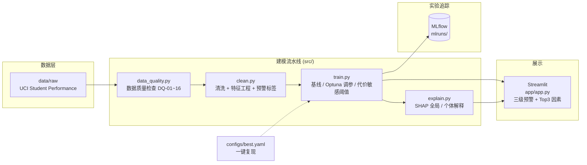

# 基于可解释机器学习的学业预警系统

> 人工智能实训项目（第二阶段：机器学习 / MLOps）—— 表格数据建模 + Optuna 调参 + MLflow 实验追踪 + SHAP 模型解释 + Streamlit 展示系统。

## 简介

基于 **UCI Student Performance** 数据集构建的可解释学业预警系统：从数据质量检查、特征工程、四模型基线对比，到 LightGBM + Optuna 调参、代价敏感阈值优化、SHAP 归因解释，最后用 Streamlit 提供可交互的三级预警展示。完整覆盖一个表格类机器学习项目的 MLOps 闭环。

- **数据**：UCI Student Performance（数学 + 葡萄牙语两门课，共 1044 条课程-学生观测）
- **建模**：LightGBM / XGBoost / 随机森林 / 逻辑回归四模型基线，Optuna 自动调参
- **工程**：MLflow 实验追踪、`configs/best.yaml` 一键复现、统一图表规范（`src/viz.py`）
- **解释**：SHAP 全局 + 个体解释，展示系统给出「三级预警 + 影响 Top3 因素 + 干预建议」
- **业务取向**：宁可多报、不可漏报——代价敏感阈值把召回率从 28.3% 提升到 69.6%

## 架构



## 项目结构

```
student-risk-prediction/
├── app/                 # Streamlit 展示系统 (加分项)
│   └── app.py
├── configs/
│   └── best.yaml        # 最优模型配置 (调参后回填, 一键复现)
├── data/
│   ├── raw/             # 原始数据 (UCI Student Performance)
│   └── processed/       # 清洗后建模数据
├── notebooks/           # EDA 探索 (可选)
├── reports/
│   └── figures/         # 统一图表输出 (图1-1, 图2-1 ... 自动编号)
├── src/
│   ├── viz.py           # ★ 统一配色 / 中文字体 / 图表编号模块
│   ├── data_quality.py  # 数据质量检查 →《数据质量分析报告》
│   ├── clean.py         # 清洗 + 特征工程
│   ├── train.py         # 建模 + Optuna 调参 + MLflow 追踪
│   └── explain.py       # SHAP 全局/个体解释
└── requirements.txt
```

## 安装与环境

要求 Python 3.10+。建议使用虚拟环境：

```bash
python -m venv .venv
# Windows:
.venv\Scripts\activate
# macOS / Linux:
source .venv/bin/activate

pip install -r requirements.txt
```

## 准备数据

原始数据来自公开的 [UCI Student Performance](https://archive.ics.uci.edu/dataset/320/student+performance) 数据集（两个 CSV：`student-mat.csv`、`student-por.csv`，分号分隔）。仓库出于版权与体积考虑**不包含原始数据**，请按以下步骤放置：

```text
data/
└── raw/
    └── student_files/
        ├── student-mat.csv   # 数学课程
        └── student-por.csv   # 葡萄牙语课程
```

> 程序通过 `src/data.py` 中的 `RAW_DIR = data/raw/student_files` 读取这两个文件；缺少文件时会直接报错，请先放置到位再运行。

## 快速开始

```bash
# 1. 数据质量检查 + 清洗 + EDA
python -m src.data_quality
python -m src.clean
python -m src.eda

# 2. 训练 / 复现实验
python -m src.train --baseline                # 4 模型基线对比
python -m src.train --tune --n-trials 40      # Optuna 调参
python -m src.train                           # 用 best.yaml 一键复现

# 3. 模型解释 (SHAP)
python -m src.explain

# 4. 展示系统
streamlit run app/app.py

# 5. 查看实验追踪
mlflow ui --backend-store-uri ./mlruns
```

> 说明：README 快速开始一节写的是 `sqlite:///mlflow.db`，但 `src/train.py` 与 `configs/best.yaml` 实际使用 `./mlruns` 作为追踪目录，`mlflow ui` 请以 `./mlruns` 为准（上方命令已按实际实现校正）。

## 核心指标

基线对比（同一 80/20 分层划分，阈值 0.5，随机种子 42）：

| 模型 | AUC | F1 | Precision | Recall |
|---|---|---|---|---|
| LightGBM（基线） | 0.808 | 0.468 | 0.581 | 0.391 |
| XGBoost（基线） | 0.784 | 0.500 | 0.553 | 0.457 |
| 随机森林（基线） | 0.780 | 0.429 | 0.625 | 0.326 |
| 逻辑回归（基线） | 0.770 | 0.457 | 0.667 | 0.348 |

调参与代价敏感阈值（LightGBM + Optuna 40 trials）：

| 配置 | 验证集 AUC | 测试集 AUC | 阈值 | F1 | Precision | Recall |
|---|---|---|---|---|---|---|
| 调参后 @ 默认阈值 0.5 | 0.869 | 0.783 | 0.50 | 0.366 | 0.520 | 0.283 |
| 调参后 @ 代价敏感阈值 | 0.869 | 0.783 | 0.21 | 0.500 | 0.390 | **0.696** |

**结论（口径与报告保持一致）**：
- Optuna 将**验证集** AUC 提升至 0.869；测试集 AUC 在 0.78~0.81 区间小幅波动（小样本下验证/测试存在随机差异，如实呈现）。
- 业务上更看重**不漏报高危学生**：代价敏感阈值（漏报代价 5 倍于误报）把召回率从 28.3% 提升到 69.6%，F1 从 0.37 提升到 0.50，以约 13 个百分点的精确率换取大幅降低漏报，符合"预警宁可多报、不可漏报"的业务取向。
- 最优参数与阈值已回填 `configs/best.yaml`，`python src/train.py` 可一键复现（指标逐位一致）。
- 全部实验记录在 MLflow（`sqlite:///mlflow.db`），查看：`mlflow ui --backend-store-uri sqlite:///mlflow.db`。

## 图表规范

所有图表由 `src/viz.py` 统一管理：莫兰迪蓝灰配色、中文字体（微软雅黑/黑体）、300dpi、自动编号（图{章}-{序号}）并附图注。报告中引用图表时使用其返回的编号。

## 测试

当前项目以「脚本可复现 + 指标可核验」为主，尚未引入 pytest 单测套件。你可以这样验证核心链路：

```bash
# 数据质量检查通过（生成《数据质量分析报告》）
python -m src.data_quality

# 一键复现最优模型，终端输出指标应与下表逐位一致
python -m src.train
```

> 如需把关键函数（如 `clean.py` 的标签构造、`train.py` 的代价敏感阈值优化）固化为自动化回归测试，可在 `tests/` 下补充 pytest 用例，欢迎贡献。

## 技术栈

| 类别 | 依赖 |
|---|---|
| 数据处理 | pandas、numpy |
| 可视化 | matplotlib、seaborn |
| 建模 | scikit-learn、lightgbm、xgboost |
| 调参 | optuna |
| 实验追踪 | mlflow |
| 模型解释 | shap |
| 展示系统 | streamlit |

## License

MIT

